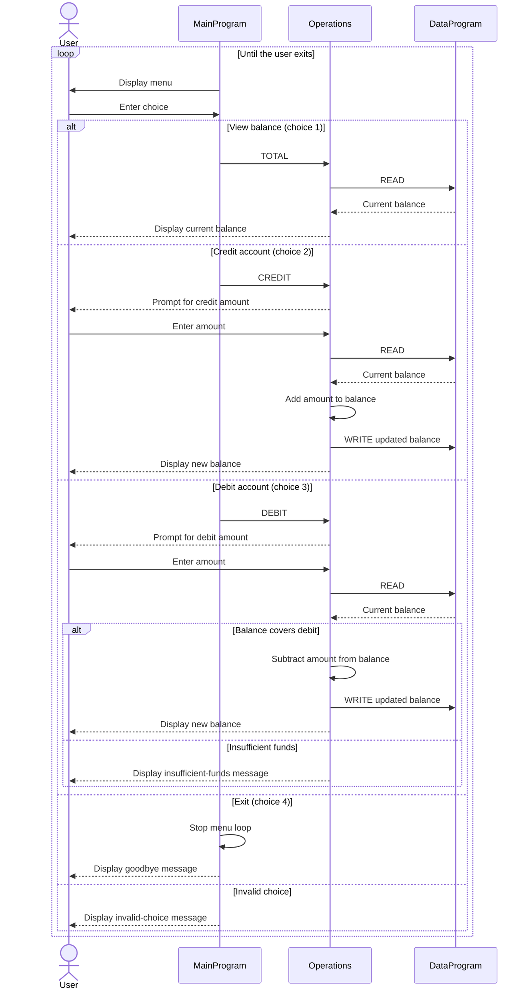

# COBOL Account Management

This directory documents the COBOL account-management example in `src/cobol/`. The program provides a menu for viewing a balance, crediting an account, and debiting an account.

## Source Files

| File | Purpose |
| --- | --- |
| [`main.cob`](../src/cobol/main.cob) | Runs the interactive menu, reads the user's choice, and calls `Operations` for balance, credit, or debit requests. Choice 4 exits the program; other choices display an error. |
| [`operations.cob`](../src/cobol/operations.cob) | Implements the account actions. It reads the stored balance before displaying or changing it, prompts for amounts for credits and debits, and reports the result. |
| [`data.cob`](../src/cobol/data.cob) | Owns the balance in `STORAGE-BALANCE` and exposes `READ` and `WRITE` operations through its linkage parameters. The stored balance starts at `1000.00`. |

## Account Rules and Behavior

- The program keeps one balance shared by all operations. It does not store student names, IDs, or separate balances, so it does not currently implement individual student accounts.
- The initial balance is `1000.00`. It is held in memory while the program runs; there is no file or database persistence.
- A credit adds the entered amount to the balance and stores the result.
- A debit is allowed only when the balance is greater than or equal to the entered amount. Otherwise, the program displays an insufficient-funds message and leaves the balance unchanged.
- Amount fields use `PIC 9(6)V99`, which represents up to six integer digits and two fractional digits. The program does not explicitly reject zero or negative amounts, or validate input beyond the COBOL field definitions.

## Operation Flow

`MainProgram` dispatches a six-character operation name to `Operations`. `Operations` calls `DataProgram` with `READ` to retrieve the balance and with `WRITE` to save a changed balance. `DataProgram` copies between the passed balance and its working-storage balance.

## Sequence Diagram

